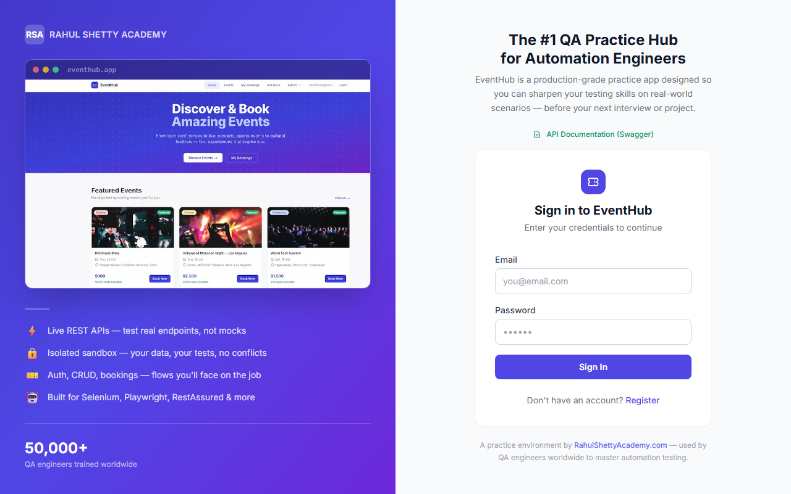
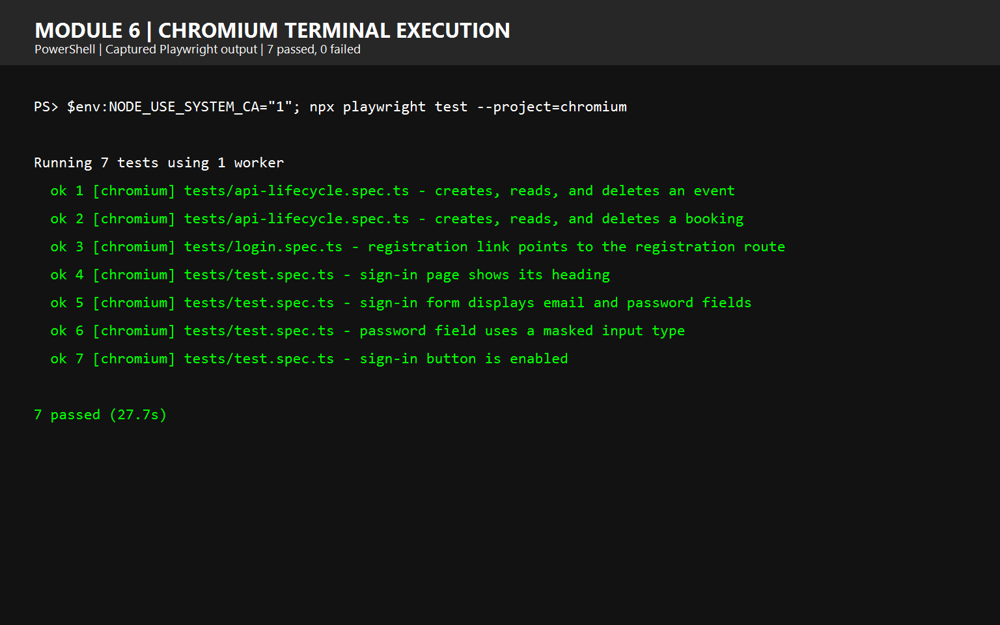
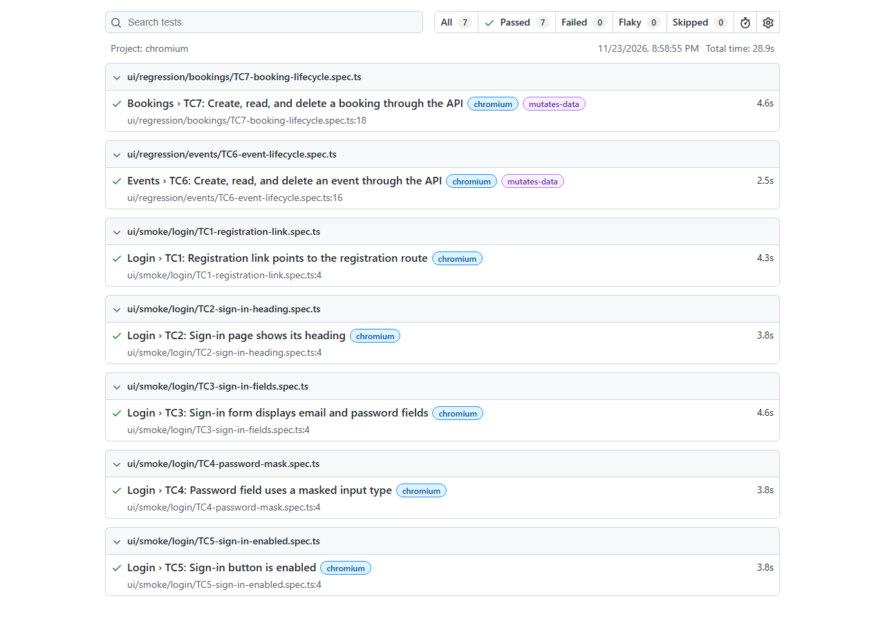

# Module 6 - Prompt and Skill Evidence

**Repository:** https://github.com/nic046/Web-Aplication-First-Test-Case/tree/main

## 1. Prompt execution

I used the requirements and test-data prompts with the two previous lifecycle scenarios:

- **TC6:** create, read, and delete an event.
- **TC7:** create a temporary event, create and read a booking, then delete both resources.

The requirements prompt produced complete TC specifications. The data prompt found that payloads
were written inside the specs and moved their factory to
[events.data.ts](../../src/data/events.data.ts).

## 2. Skill verification

I ran both skills directly against the repository and compared the results with their required
formats.

| Skill | Result |
|---|---|
| `spec-requirements-standard` | TC6 and TC7 were both Ready with a 100% score. |
| `spec-data-standard` | Found R7 inline payload data and R11 missing mutation tags, then corrected both. |
| `spec-organisation-standard` | All specs used the required folder, TC names, and `test.step()` structure. |

The result matched the expected violation and assessment formats.

## 3. Changes made

- Added a typed event payload factory with a unique `qa_` title.
- Added `TEST_ENV` support and environment data settings.
- Added `@mutates-data` to the API lifecycle tests.
- Added scoped cleanup for the event and booking IDs.
- Added M4 automation handoff data to [TC6](../test-cases/regression/events-test-cases.md).
- Documented the serial worker setting and why it is needed.

## 4. App evidence

## 5. Chromium execution

## 6. Final results

- TypeScript check: passed.
- Parallel data check: 4 out of 4 passed with 2 workers and 2 repeats.
- Complete Chromium suite: 7 out of 7 passed.
- Playwright HTML report: 7 passed, 0 failed.
